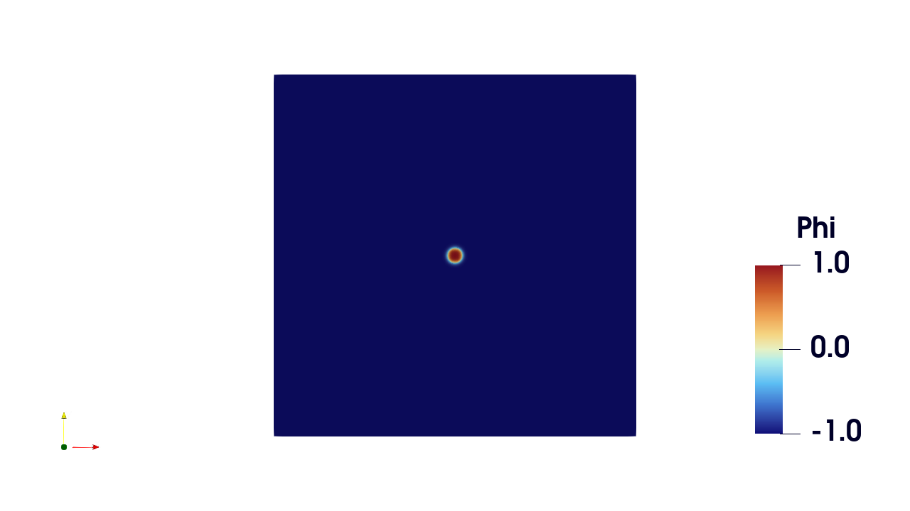
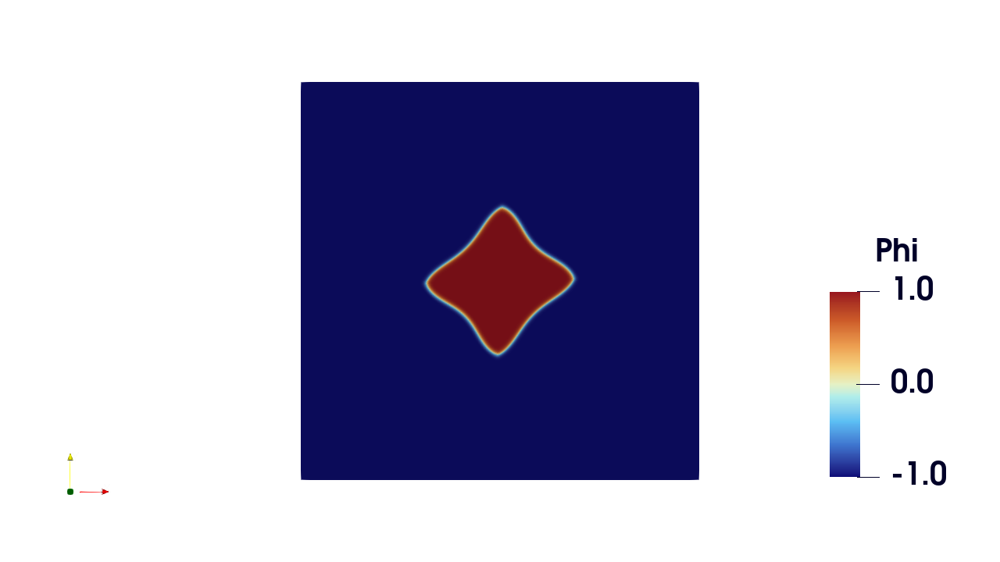
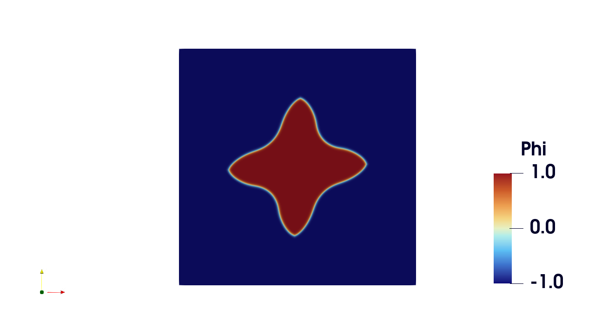

# FEniCSx Implementation of a Two-Dimensional, Thermally Coupled Phase-Field Model for Dendrite Growth

**Computational Materials Science · Phase-Field Modeling · Finite Element Analysis · Nonlinear Multiphysics · Python**

A research software project investigating two-dimensional solidification through a diffuse-interface phase-field formulation in **FEniCSx (DOLFINx)**. The implementation develops the individual physical and numerical contributions progressively—from bulk phase evolution and interfacial energy to thermal diffusion and four-fold anisotropy—with diagnostic plots and source-level checks at each stage.

> **Model status:** This repository contains both a *coupled phase-field/diffusion development solver* and an *anisotropic demonstration*. The current root-level `Final.py` uses `zet = 0` and `K = 0`, so its showcased evolution is **not a validated, thermally coupled dendrite-growth benchmark**. See [Model scope and verification status](#model-scope-and-verification-status).

## Representative simulation

<p align="center">
  
  
  
</p>

<p align="center"><em>Saved snapshots from the Task 3 anisotropy investigations. Images illustrate morphology; quantitative model validation is addressed separately.</em></p>

## Engineering problem and approach

Dendrites can emerge during solidification when the moving solid–liquid interface responds to diffusion, thermal driving and orientation-dependent interfacial properties. Rather than tracking a sharp boundary explicitly, this implementation represents the phases through an order parameter, **φ**, with approximately **+1 in solid** and **−1 in liquid**. A second field, **u**, represents nondimensional temperature/undercooling.

The development is based on the pure-metal-style phase-field formulation discussed by Bhagat and Rudraraju (2023). Its principal components are:

- **Spatial discretization:** two-dimensional triangular meshes with first-order Lagrange finite elements; a mixed `P1 × P1` space for `φ` and `u` in the coupled stages.
- **Time discretization:** implicit Backward Euler.
- **Nonlinear equations:** weak residuals written in UFL, differentiated for a Jacobian and solved with a Newton method using DOLFINx/PETSc.
- **Interface physics:** double-well bulk potential, diffuse-interface gradient energy and four-fold orientation dependence.
- **Diagnostics:** stored energy histories, interface position/thickness, balance diagnostics and dendrite-tip tracking.

### Complete governing model, including anisotropy

The phase-field and nondimensional thermal/diffusion equations used to develop this project are

$$
\boxed{
\tau_0\,a(\mathbf n)^2\,\frac{\partial\phi}{\partial t}
= -\underbrace{\left[-\phi+\phi^3+\zeta u(1-2\phi^2+\phi^4)\right]}_{\partial f/\partial\phi}
+\nabla\cdot\mathbf Q(\nabla\phi)
}
$$

$$
\boxed{\frac{\partial u}{\partial t}=D\nabla^2u+K\frac{\partial\phi}{\partial t}}
$$

The anisotropy is **not only a coefficient multiplying the gradient term**: in the implemented formulation, it changes both the interface kinetics, through $\tau_0a^2$, and the interfacial flux $\mathbf Q$.

#### Four-fold anisotropy and interfacial flux

The code (`Final.py`) defines the regularized interface normal and four-fold anisotropy function as

$$
\mathbf n=\frac{\nabla\phi}{\sqrt{|\nabla\phi|^2+\eta^2}},
\qquad
 a(\mathbf n)=(1-3\epsilon_4)+4\epsilon_4(n_x^4+n_y^4).
$$

The **complete anisotropic flux used by the source code** is

$$
\boxed{
\mathbf Q(\nabla\phi)=\lambda_0^2\left[
 a(\mathbf n)^2\nabla\phi
 +a(\mathbf n)|\nabla\phi|^2\frac{\partial a}{\partial(\nabla\phi)}
\right]}
$$

with

$$
\frac{\partial a}{\partial(\nabla\phi)}
=\frac{\mathbf I-\mathbf n\otimes\mathbf n}{\sqrt{|\nabla\phi|^2+\eta^2}}
\begin{bmatrix}16\epsilon_4 n_x^3\\16\epsilon_4 n_y^3\end{bmatrix}.
$$

Here $\epsilon_4$ is the four-fold anisotropy strength, $\lambda_0$ sets the diffuse-interface length scale, $\eta$ regularizes the interface normal, $\zeta$ controls the bulk thermal driving term, $D$ is the thermal diffusivity, and $K$ is the latent-heat coupling coefficient. The implementation uses homogeneous natural (no-flux) boundary conditions. Setting $\epsilon_4=0$ gives $a=1$ and $\mathbf Q=\lambda_0^2\nabla\phi$, recovering the isotropic gradient contribution.

#### Backward-Euler finite-element residuals

For test functions $w_\phi$ and $w_u$, the intended fully coupled formulation after multiplying by $\Delta t$ is

$$
\begin{aligned}
R_\phi={}&\int_\Omega \tau_0a(\mathbf n)^2(\phi^{n+1}-\phi^n)w_\phi\,d\Omega\\
&+\Delta t\int_\Omega \frac{\partial f}{\partial\phi}(\phi^{n+1},u^{n+1})w_\phi\,d\Omega\\
&+\Delta t\int_\Omega\mathbf Q(\nabla\phi^{n+1})\cdot\nabla w_\phi\,d\Omega=0,
\end{aligned}
$$

$$
\begin{aligned}
R_u={}&\int_\Omega(u^{n+1}-u^n)w_u\,d\Omega
-K\int_\Omega(\phi^{n+1}-\phi^n)w_u\,d\Omega\\
&+\Delta t D\int_\Omega\nabla u^{n+1}\cdot\nabla w_u\,d\Omega=0.
\end{aligned}
$$

**Implementation status:** In the current root `Final.py`, $\epsilon_4=0.05$ is active but $\zeta=0$ and $K=0$, so its recorded morphology is an **anisotropic, thermally decoupled benchmark**, not proof of fully coupled dendritic growth. Moreover, the currently checked-in thermal residual in `Final.py` and `Task_2/task_2.py` contains an additional factor of `dt` multiplying the $K(\phi^{n+1}-\phi^n)$ term, unlike the *intended* residual displayed above. That implementation must be corrected and verified before claiming coupled conservation or quantitative validation. For the complete source-level development discussion, see [Development notes](docs/DEVELOPMENT_NOTES.md) and [Verification](docs/VERIFICATION.md).

## Implementation and development stages

| Stage | Numerical focus | Source and evidence |
|---|---|---|
| **Task 0** | Local double-well phase evolution | [`Task0/task_0.py`](Task0/task_0.py), [`Task0/output/`](Task0/output/) |
| **Task 1** | Spatial gradient energy, interface motion and energy evolution | [`Task1/task_1.py`](Task1/task_1.py), [`Task1/Outputs/`](Task1/Outputs/) |
| **Task 2** | Mixed phase-field/thermal-diffusion prototype and balance diagnostics | [`Task_2/task_2.py`](Task_2/task_2.py), [`Task_2/Test/`](Task_2/Test/) |
| **Task 3** | Four-fold anisotropy, morphology and tip tracking | [`Task_3/Final.py`](Task_3/Final.py), [`Task_3/outputs/`](Task_3/outputs/) |

**Development principle:** *Build → Isolate → Verify → Couple → Verify Again*. Existing plots and diagnostic data are **development evidence**, not an assertion that every conservation or convergence test has passed.

### Selected numerical outputs

| Quantity | Existing evidence |
|---|---|
| Free-energy history | [Energy evolution](Task1/Outputs/energy_decay.png) |
| Interface propagation | [Position](Task1/Outputs/xstar_vs_time_fit.png) · [Velocity](Task1/Outputs/speed_vs_time.png) |
| Diffuse-interface width | [Thickness history](Task1/Outputs/thickness_vs_time.png) |
| Coupling diagnostics | [Balance](Task_2/out_task2/balance.png) · [Recorded diagnostics](Task_2/out_task2/diagnostics.csv) |
| Anisotropic tip propagation | [Tip velocity](Task_3/outputs/1/v_tip_vs_time.png) · [Tip trace](Task_3/outputs/1/tip_trace.csv) |

## Model scope and verification status

The current main solver, [`Final.py`](Final.py), has the following configuration:

| Parameter | Current value |
|---|---:|
| Domain | `250 × 250` (nondimensional) |
| Mesh divisions | `250 × 250` (triangular elements) |
| Time step / end time | `0.04` / `200` |
| Initial solid-seed radius | `5` |
| Initial undercooling | `u₀ = -0.65` |
| Diffusion coefficient | `D = 1` |
| Four-fold anisotropy | `ε = 0.05` |
| Bulk thermal coupling / latent coupling | `zet = 0` / `K = 0` |

**Interpretation:** The root solver retains a mixed two-field discretization, but these particular coefficients disable phase–temperature feedback and latent-heat release. Task 2 develops a coupled formulation separately. A source-level review identified a mismatch between its documented Backward-Euler latent-heat term and its implemented residual; the correction, rerun and conservation check are pending. Accordingly, **fully coupled anisotropic growth, mesh/time-step convergence and reference tip-speed agreement are not presented as established results**.

See [Verification plan and known checks](docs/VERIFICATION.md) for the specific acceptance tests and implementation items to resolve.

## Getting started

**Requirements:** a working, mutually compatible installation of **Python, DOLFINx/FEniCSx, UFL, Basix, PETSc/petsc4py, MPI/mpi4py and NumPy**. Visualization and analysis utilities additionally use tools including Matplotlib, PyVista and OpenPyXL. **Exact dependency versions are not yet pinned**, so environment reproduction remains a project improvement item.

For the current anisotropy-focused root solver, in a working Linux/WSL2 FEniCSx environment:

```bash
git clone https://github.com/KartikTandel30/fenicsx-thermally-coupled-dendrite-growth.git
cd fenicsx-thermally-coupled-dendrite-growth
mkdir -p out_task3_6
python Final.py
```

To attempt an MPI run, use an MPI installation compatible with the configured DOLFINx/PETSc environment:

```bash
mpirun -np 4 python Final.py
```

The `out_task3_6/` directory must exist **before** running this version of `Final.py`. Output is written as XDMF/HDF5 time-series data. The default parameters correspond to a relatively large transient calculation; check computational resources before running. See the [reproducibility guide](docs/REPRODUCIBILITY.md) for environment checks, Windows considerations and the development-stage entry points.

## Repository navigation

```text
.
├── Final.py                    # Current anisotropy-focused mixed-field solver
├── PPP.pdf                     # Project report
├── README.md                   # Portfolio overview (this page)
├── docs/
│   ├── DEVELOPMENT_NOTES.md    # Archived original, detailed README
│   ├── REPRODUCIBILITY.md      # Environment and execution notes
│   └── VERIFICATION.md         # Verification checklist and open items
├── Task0/                      # Bulk phase-field model and outputs
├── Task1/                      # Gradient-energy model and diagnostics
├── Task_2/                     # Coupled-development model and diagnostics
└── Task_3/                     # Anisotropy investigations and tip analysis
```

## Documentation and scientific reference

- [Full technical development notes](docs/DEVELOPMENT_NOTES.md) — original detailed README retained, with mathematical formulation and task-by-task figures.
- [Verification plan](docs/VERIFICATION.md) — test matrix and checks still to complete.
- [Reproducibility guide](docs/REPRODUCIBILITY.md) — execution details and dependency limitations.
- [PPP technical report](PPP.pdf).

**Scientific reference:** K. Bhagat and S. Rudraraju, *Modeling of dendritic solidification and numerical analysis of the phase-field approach to model complex morphologies in alloys*, **Engineering with Computers**, 39, 2345–2363 (2023). The code in this repository is a project implementation informed by this publication; it is not presented as the authors' official software.

## Project context and author

Developed as a Personal Programming Project (PPP) within the **M.Sc. Computational Materials Science** programme at **TU Bergakademie Freiberg**.

**Kartik Suresh Tandel** · Computational Materials Science · Finite Element Methods · Phase-Field Modeling
